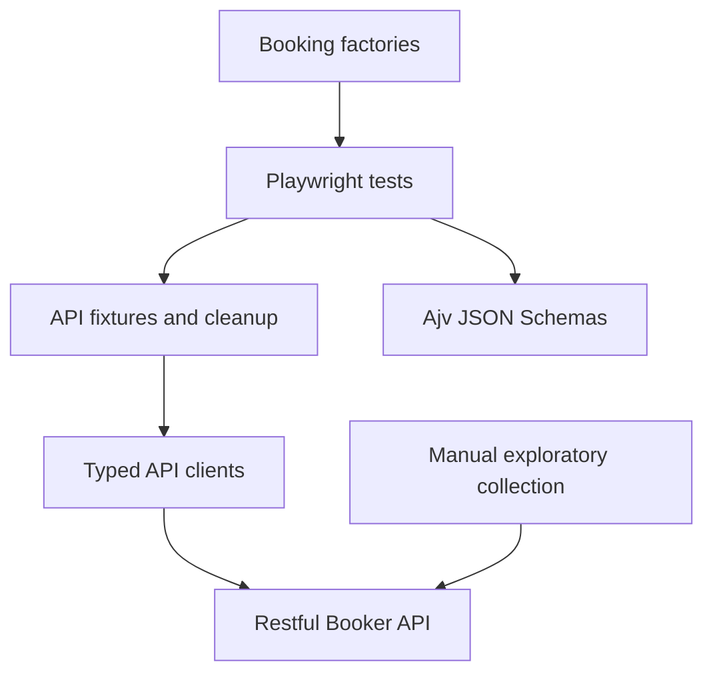

# Restful Booker API Testing Framework

Professional REST API testing framework using Playwright, TypeScript, Ajv, Postman, and GitHub
Actions for the public [Restful Booker API](https://restful-booker.herokuapp.com/apidoc/index.html).
The automated suite provides repeatable API checks; the Postman collection complements it with
manual and exploratory coverage.

## Objectives

- Exercise the documented authentication and booking API.
- Validate HTTP behavior, response contracts, and authentication boundaries.
- Keep HTTP clients, fixtures, factories, schemas, and assertions in separate responsibilities.
- Characterize observed service deviations without presenting them as desired contracts.

## Technology stack

- Node.js 20 or newer
- TypeScript with strict compiler settings
- Playwright API testing
- Ajv JSON Schema validation
- ESLint and Prettier
- Postman and optional Newman execution
- GitHub Actions

## Architecture



- `src/clients/` owns HTTP request construction.
- `src/fixtures/` provides clients, authentication, and created-resource cleanup.
- `src/data/` generates unique and invalid payloads.
- `src/schemas/` and `src/utils/` validate response contracts.
- `tests/` contains assertions and scenario organization.

## Installation

```bash
npm ci
```

## Environment configuration

Copy `.env.example` to `.env` when local authenticated execution is required:

```dotenv
API_USERNAME=your-restful-booker-username
API_PASSWORD=your-restful-booker-password
BASE_URL=https://restful-booker.herokuapp.com
API_TIMEOUT=15000
```

`BASE_URL` and `API_TIMEOUT` have validated defaults. `API_USERNAME` and `API_PASSWORD` must be
provided together. Public unauthenticated tests can run without credentials; authenticated tests
fail with a clear configuration error when the pair is missing. Invalid-credential scenarios use
test data and do not require valid credentials.

## Execution

```bash
npm test
npm run test:auth
npm run test:bookings
npm run test:negative
npm run test:contracts
npm run test:health
```

Quality checks:

```bash
npm run typecheck
npm run lint
npm run format
npm run format:check
```

Open the latest HTML report with:

```bash
npm run report
```

## Test coverage

The implemented suite covers health availability, authentication responses, booking retrieval and
filters, creation, complete updates, partial updates, deletion, unauthorized operations, malformed
requests, invalid payloads, and response contracts. Exact result counts are intentionally not
claimed because the public API is shared and stateful.

### Authentication strategy

The API uses the Restful Booker cookie token mechanism for protected booking operations. Credentials
are read from environment variables and are never logged. Tests that use invalid credentials remain
independent of valid environment credentials.

### CRUD testing

Booking tests create unique resources through the tracker, use the returned ID for subsequent
operations, and clean up resources during fixture teardown. Tests do not mutate fixed or
unowned bookings.

### Negative testing

Negative scenarios cover missing fields, malformed JSON, invalid data, missing tokens, invalid
tokens, and non-existing IDs. Scenarios that describe real but undocumented service behavior are
marked `[observed]` and documented as deviations.

### JSON Schema validation

Ajv validates authentication, booking, and booking-list response contracts. HTTP clients return the
non-generic Playwright `APIResponse`; response bodies are decoded and validated separately.

## Postman collection

Import [postman/api-testing-collection.json](postman/api-testing-collection.json) and
[postman/environments/local-environment.json](postman/environments/local-environment.json) into
Postman. Select the environment and fill in `username` and `password` locally. Run the collection
in Collection Runner order so authentication and booking creation save `token` and `bookingId`;
the final lifecycle step deletes the created booking.

The environment contains empty secret placeholders and is safe to push. Newman is optional and is
not a project dependency:

```bash
npx newman run postman/api-testing-collection.json -e postman/environments/local-environment.json
```

## CI/CD

`.github/workflows/api-tests.yml` runs on pushes and pull requests using Ubuntu and Node.js 22. It
installs with `npm ci`, runs typecheck, lint, formatting, and the API suite, and uploads Playwright
reports and test results even when tests fail.

For authenticated tests, configure these repository secrets:

- `API_USERNAME`
- `API_PASSWORD`

Fork pull requests may not receive repository secrets. In that case, authenticated tests require a
trusted workflow context with the secrets configured; no credentials are printed by the workflow.

## Reporting

Playwright writes the HTML report to `playwright-report/` and raw test output to `test-results/`.
GitHub Actions uploads both directories as artifacts regardless of test outcome.

## Known limitations

- The public API is shared, stateful, and can change outside this repository.
- Observed statuses and bodies are evidence from recorded executions, not immutable guarantees.
- Authenticated scenarios require valid credentials.
- Newman execution requires network access and locally supplied credentials.

## Future improvements

- Add a controlled service or isolated environment for deterministic CI data.
- Publish a versioned contract-diff report for observed API changes.
- Add scheduled compatibility runs with retained historical reports.
